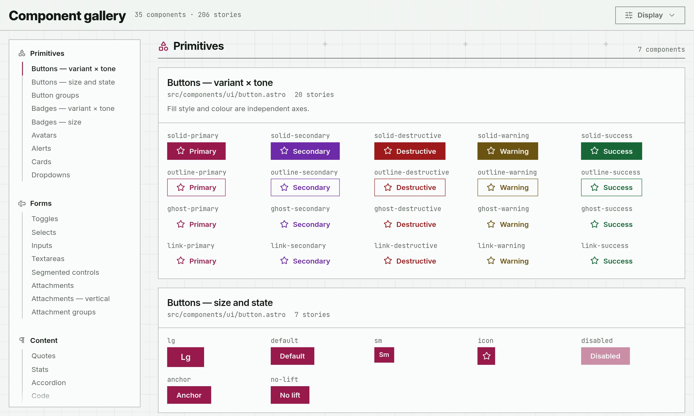

<div align="center">

# website

Source code for my website, and the components it's built from.

[](https://github.com/CPlusPatch/website/actions/workflows/ci.yml)
[](LICENSE)
[](packages/ui/COPYING.LESSER)
[](https://astro.build)
[](https://deno.com)

**[Open the gallery](https://cpluspatch.com/gallery/)** · [Docs](docs/) · [License](LICENSE)

<picture>
  <source media="(prefers-color-scheme: dark)" srcset="docs/assets/gallery-dark.webp">
  
</picture>

</div>

## About

This is my website with a collection of web components I used to make it. Every component is in the [gallery](https://cpluspatch.com/gallery/), where you can try it in different themes, screen sizes and colour schemes.

Some things it has:

- Plain HTML and CSS, with JavaScript only where a component really needs it
- Everything still works with JavaScript turned off
- A bunch of colour themes, each with a light and dark mode
- A few toys, like a gravity gun that lets you throw parts of the page around

## Running it locally

You'll need [Deno](https://deno.com) 2.

```sh
deno install
deno run dev
```

The dev server runs on http://localhost:4321. Other scripts:

```sh
deno run build      # build to dist/
deno run preview    # serve the build
deno run check      # lint, typecheck and tests (same as CI)
deno run lint:fix   # format and autofix
deno run theme      # regenerate the theme colours
deno run bad-apple  # regenerate the terminal's Bad Apple!! (needs ffmpeg and yt-dlp)
deno run movie <file or URL>  # a colour film for the terminal's `movie` (kept out of git; or set PUBLIC_MOVIE_URL)
deno run shorts src/data/shorts-videos.txt  # videos for <Shorts> (needs ffmpeg and yt-dlp; kept out of git)
deno run radio src/data/radio-tracks.txt  # music for <Radio>, from YouTube Music links (same needs; kept out of git)
```

## Layout

```
website/
├── src/
│   ├── components/     what belongs to this site (the front page's sections, the radio, ...)
│   │   ├── page/       the front page's sections
│   │   ├── blocks/     site-specific blocks (radio, shorts, the terminal's commands, ...)
│   │   └── effects/    page-wide effects like the scanlines
│   ├── gallery/        the gallery and its stories
│   └── styles/         imports the library's CSS
├── packages/
│   ├── ui/             @cpluspatch/ui: tokens, themes, CSS, behaviours, class builders,
│   │                   and the Astro components (src/astro: ui/, blocks/, sections/).
│   │                   See its README
│   ├── palette/        theme colour generator
│   ├── destructor/     the gravity gun
│   ├── reel/           downloads videos for <Shorts>
│   ├── mixtape/        downloads music for <Radio>
│   ├── grab/           what reel and mixtape share (yt-dlp, retries)
│   └── flipbook/       shrinks videos for the terminal
└── docs/               guides, linked below
```

## Docs

- [The UI library](packages/ui/README.md)
- [Development workflow](docs/workflow.md)
- [Design philosophy](docs/philosophy.md)
- [Adding a component](docs/components.md)
- [Themes and colours](docs/themes.md)

## License

The site is licensed under the [GNU AGPL v3](LICENSE).

The component library in [`packages/ui`](packages/ui) (`@cpluspatch/ui`) is licensed under the [GNU LGPL v3](packages/ui/COPYING.LESSER) (with [the GPL it builds on](packages/ui/COPYING)), so you can use it in a site under any license. It is not published to a registry yet.
